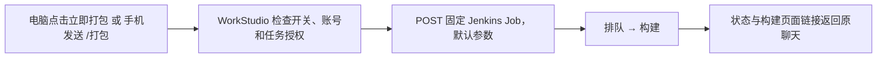

# 固定 iOS 打包 Job

2026-11-10 用户指定只接入 `http://172.16.8.85:8080/job/SurvivorTD_IOS_Auto/`。打开“打包”窗口不会启动构建；“立即打包”或任务聊天中的精确指令 `/打包`（也支持 `/build`）才提交。

电脑打包窗口首次填写 Jenkins 用户名和 API Token，保存并开启。凭据存入 Windows 凭据管理器独立条目 `AgentMonitorOverlay/model-provider/jenkins-survivortd-ios`；接口只返回是否保存和用户名。不要在模型聊天里发送 Token。Jenkins API Token 是服务器验证接口请求用的，不自动读取 Chrome 登录 Cookie，也不绕过 Jenkins 权限。

桌面可以直接点击“立即打包”。手机使用自己的同账号、在电脑确认配对并获得当前任务授权后，在会话发送 `/打包`，或从会话菜单选择“执行 iOS 打包”。Host 在发给模型前处理该指令，因此不消耗模型对话；其他账号即使获当前任务授权，也不能触发这个 Job。只接受固定命令，不接受聊天提供的 URL、shell 或构建参数。

通过 Jenkins [官方 Remote Access API](https://www.jenkins.io/doc/book/using/remote-access-api/) 提交 `POST .../build?delay=0sec`，等待 201 队列地址，再轮询此队列对应的构建。API Token 身份验证不需要关闭 CSRF。只读取构建状态，不拉完整构建日志或上传本机源码/文件。不会跟随跨服务器跳转，队列和构建地址必须属于指定 Jenkins/Job。

正在排队或执行时防重复提交。POST 超时可能已被 Jenkins 接收，显示“结果未知”且绝不自动重试；请先查看 Job。Host 重启后可点“刷新结果”继续检查已有队列/构建，不会重新提交。关闭合作模式使手机无法下指令；关闭打包指令使按钮/命令停止触发，已经在 Jenkins 运行的构建继续。

当前真实 Jenkins 未登录接口返回 403，浏览器工具也未获准访问 Chrome。代码与模拟 Jenkins 测试已就绪，但真实自动触发需在电脑配置有效 API Token 后验收。当前地址是 HTTP，认证信息经过可信公司局域网；没有配置 TLS 或公网访问。
