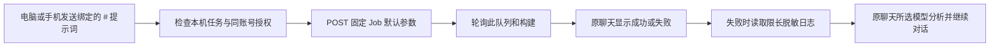

# 固定 iOS / 安卓打包

本 fork 仅接入用户指定的两个 Jenkins Job：

- iOS：`http://172.16.8.85:8080/job/SurvivorTD_IOS_Auto/`
- 安卓：`http://172.16.8.85:8080/job/SurvivorTD_Android_Auto/`

顶栏“打包”可选择平台并提交默认参数；打开窗口本身不会启动构建。首次填写 Jenkins 用户名和 API Token，保存并开启。凭据仍保存在 Windows 凭据管理器条目 `AgentMonitorOverlay/model-provider/jenkins-survivortd-ios`（兼容旧版本，两平台共用）；接口不返回 Token。不读取浏览器 Cookie，不接受聊天里的任意 Job URL、shell 或构建参数。

## 在聊天里使用

输入 `#` 选择“高配打包机 自动出IOS包”或“高配打包机 自动出安卓包”，会填入对应默认任务。只有点击发送才提交一次构建。新聊天也支持，任务会用首句话命名。普通自定义提示词仍发送给当前模型。配置方法见 [本地提示词设置](chat-presets.md)。

日志最多读取末尾 48000 字节，隐藏本机保存的 Jenkins 凭据及常见 Token、密码格式，然后作为不可信诊断数据交给同一聊天所选模型。脱敏无法识别所有业务机密，Jenkins 日志应避免输出密钥。选用的模型服务会收到这段日志。模型分析失败时提示继续提问；不自动修复代码或重复提交构建。

同账号手机须连接电脑使用的账号服务、完成配对，并获得当前任务授权，才能触发两个 Job。其他账号即使获任务授权，也不能触发打包。历史指令 `/打包`、`/build` 继续触发 iOS（仅状态通知，不自动分析）；手机会话菜单兼容这一入口，两个平台及自动分析从 `# 提示词` 进入。

## 提交和结果边界

按 Jenkins Remote Access API 提交一次 `POST .../build?delay=0sec`，等待 201 的队列地址再轮询。队列和构建地址必须属于固定服务器及对应 Job；不跟随重定向。排队或执行时防重复提交。POST 超时可能已被接收，显示“结果未知”，不自动重试，请先核对 Jenkins 页面。Host 重启后可点“刷新结果”继续查询已知队列，不会重新提交。

关闭合作模式会阻止手机下指令；关闭打包开关会停止新构建触发，已在 Jenkins 上运行的构建不受影响。电脑直接按钮触发若没有关联聊天，只在打包窗口显示结果。

本机已配置专用 API Token，验证身份认证成功、两个固定 Job 的读取均返回 200 且可构建；未实际触发打包。已用模拟 Jenkins 验证两个 Job、重复提交保护、日志脱敏与原聊天分析，真实构建流程仍待执行验收。本地址是公司局域网 HTTP，尚无 TLS 或公网入口。Token 保存在本机 Windows 凭据管理器，不随仓库提交。
