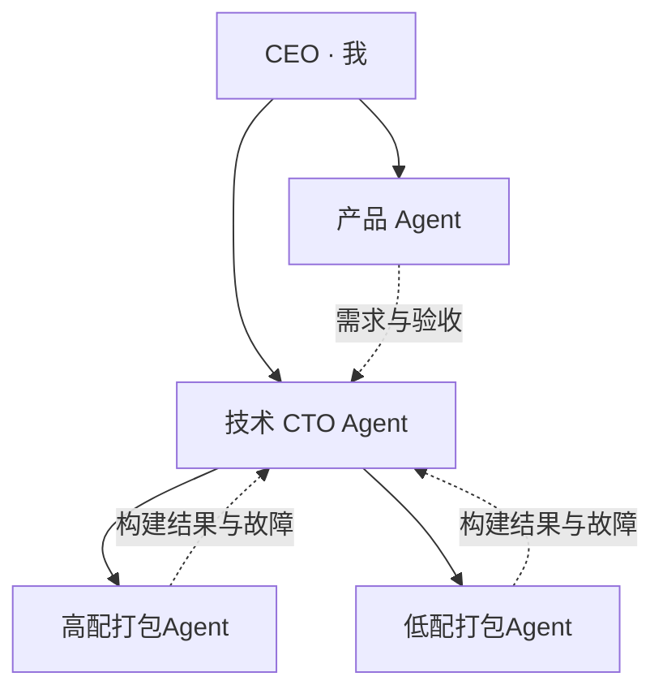

# WorkStudio：组织、Agent 与工作群

状态：做完（源码与本机历史归档，2026-11-13）。按用户要求只做隔离验证和提交推送；正式构建、加载与运行界面验收待用户另行安排，当前工具不编译、不刷新、不重启。

## 用户决定（2026-11-13）

- CEO 是用户本人，负责目标、优先级、预算和最后决策。
- 产品 Agent 负责需求、产品方案、验收条件与分工；技术 CTO Agent 负责技术方案、工程约束、风险和交付评审。
- 「远程高配机器」对应高配打包Agent；另设低配打包Agent，机器分别标记为 172.16.8.85 和 172.16.8.160。机器标签不代表已检测到硬件规格或连通性。
- 明确授权收集上述高配聊天、指定 Codex「低配172.16.8.160」历史和当前产品设计聊天，保存完整本机归档。此授权只覆盖明确指定的资料，不开放对其它原生客户端历史的扫描、共享或恢复。
- 建立类似群聊的协作入口，通过 @ 指定 Agent 发消息、派工作；提供独立 Agent 管理和组织架构，保留现有项目、聊天和任务流程。
- 完成源码后允许提交并推送本 fork 的 GitHub；不打包、不发布、不改正在运行的工作现场。

## 组织与责任

产品 Agent 提供可执行的任务说明：要解决的问题、涉及项目、交付物和验收条件。CTO 将它转成技术任务，指定执行 Agent、机器和依赖，审阅执行结果。打包 Agent 负责构建准备、现有流水线的执行、日志定位和产物交接，不代替 CEO 决定发布或升级当前工作台。

高配 Agent 优先承担完整构建和较重的诊断；低配 Agent 优先承担预检查、增量验证、轻量构建和兼容性复查。这是初始分工建议；吞吐、磁盘和内存未实测，不显示虚构的机器性能评分或自动跨机器迁移。每个 Agent 默认一次处理一项工作，正在运行的会话收到新任务时排队，保留人工停止状态。

构建任务应明确项目/分支或提交、平台、构建类型、验收命令和产物位置。重试必须核对前次结果，超时不自动重跑。现有固定 Jenkins 打包入口和文件外发确认保持有效。Agent 的机器地址是职责资料，不是任意远程 shell 的 API。

## 桌面导航与交互

新增「工作群」「Agent 管理」「组织架构」入口，与原有项目聊天并列。

- 工作群：左侧群列表，中间消息与输入框，右侧成员和分工。预置公司群和打包协作群，可新增群并选择成员。@ 使用稳定的成员 ID；普通讨论只记录在群中，明确 @ 才投递给对应 Agent。
- Agent 管理：查看名称、职责、汇报对象、运行状态、模型、项目、工作会话、机器说明与历史资料。Agent 是长期身份，会话是执行载体，避免把一个历史聊天当成不可更换的员工身份。
- 组织架构：清晰展示 CEO、产品、CTO、执行 Agent 的汇报关系；编辑时禁止自我汇报和循环关系。
- 消息：保留发送者、回复对象、@ 对象、时间和投递状态；失败保留草稿，重复点击或网络重发使用幂等 ID。长历史分页读取。
- 执行：已绑定会话优先复用；没有工作会话时，在已配置模型和项目下创建 WorkStudio 自建会话。绑定动作本身不启动模型。运行中的工作不因群消息被中断。
- 回报：Agent 可通过本机群聊工具回群回复或 @ 同事。发送者来自会话身份，不能伪装 CEO；Agent 互相唤醒限制链路长度，防止无休止互相触发。

## 历史资料与首次加载

归档包含用户明确指定会话的完整来源文件或结构化条目、可见对话、工具事件、相关附件和 SHA256 清单。正在运行的聊天按只读快照收集，并记录截止时间；之后的实时内容仍在原会话中。私有原文和本机初始化包不进入 Git。

首次加载从数据目录内的 `company-bootstrap.json` 读取已准备的 Agent 绑定和资料清单，只处理列出的文件。历史资料位于 `company-archives/` 内，路径及文件哈希通过校验后挂到 Agent 资料页。原生历史不作为可恢复的 runtimeRef，不自动混入群聊、模型上下文、手机或团队同步。后续工作使用 WorkStudio 自建会话。

## 实现与验收边界

持久化组织、成员、群、消息与投递记录，Host 提供有类型的本机接口和受会话身份约束的群聊工具。界面沿用现有视图表、Host 事件订阅和有类型的 API 客户端。

检查覆盖：组织关系与绑定校验、群成员与发送者身份、@ 投递、繁忙会话排队、消息幂等、历史分页、归档路径/哈希、失败恢复及回报去重。源码使用 noEmit 类型检查和独立临时数据库测试。界面使用真实样式的独立静态预览核对布局，不加载当前运行窗口；正式构建与现有 Host 上的验收等用户另行安排。

本机初始化包只在未来新版 Host 加载公司工作台时应用；它不会提前修改现有任务库或启用 Agent。高配绑定已存在的 WorkStudio 会话；低配、产品和 CTO 预先填写本机模型与项目，首次收到明确 @ 后创建独立工作会话。资料快照截止于 2026-11-13 11:19（北京时间），快照后原会话继续产生的内容仍由原会话保管。
